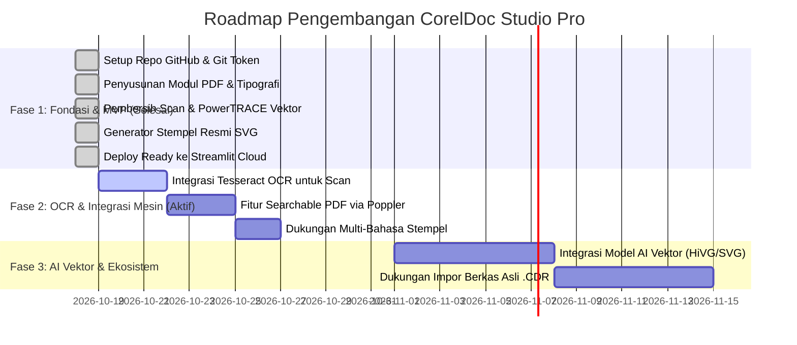

# Product Requirements Document (PRD)
## CorelDoc Studio Pro: Platform Transformasi Dokumen, Tipografi & Grafis Vektor

- **Nama Produk:** CorelDoc Studio Pro
- **Repositori:** [https://github.com/indri007/corel](https://github.com/indri007/corel)
- **Versi Dokumen:** 1.1 (Memperhitungkan Integrasi Poppler & Tesseract OCR)
- **Tanggal Pembaruan:** 18 Oktober 2026
- **Status:** Dalam Pengembangan Aktif (Fase Implementasi & Penyempurnaan)
- **Target Deployment:** Streamlit Community Cloud & Local On-Premise

---

## 1. Executive Summary & Latar Belakang

Banyak pengguna bisnis, lembaga pemerintahan, akademisi, dan profesional di Indonesia menghadapi kendala saat memproduksi atau mengelola dokumen:
1. **Kualitas Dokumen Scan yang Buruk:** Hasil pindaian seringkali berlatar belakang abu-abu kotor, teks buram, miring, dan tidak dapat dicari (*searchable*).
2. **Ketergantungan pada Software Desain Berat:** Menggunakan CorelDRAW Graphics Suite atau Adobe Illustrator membutuhkan lisensi berbayar mahal dan kemampuan teknis desain yang rumit hanya untuk menambahkan kop surat, stempel resmi, atau watermark.
3. **Kebutuhan Format Siap Cetak (Press-Ready):** Dokumen eksekutif memerlukan tata letak rapi (*justified typography*, nomor halaman terstandar, verifikasi QR Code digital, dan ketajaman vektor 300 DPI).

**CorelDoc Studio Pro** hadir sebagai solusi berbasis web (*Streamlit Web Application*) yang menggabungkan presisi grafis vektor ala CorelDRAW dengan kemudahan otomatisasi dokumen untuk mentransformasikan draf/scan mentah menjadi dokumen korporat resmi dan profesional dalam hitungan detik.

---

## 2. Visi Produk & Sasaran Utama

### Visi Produk
Menjadi studio otomatisasi dokumen dan grafis vektor open-source terkemuka yang dapat diakses langsung melalui peramban web tanpa instalasi software desktop yang rumit.

### Sasaran Utama (Key Objectives)
- **Kecepatan Proses:** Transformasi dokumen PDF atau perbaikan gambar scan selesai dalam < 3 detik per halaman.
- **Standar Grafis Vektor:** Seluruh elemen ornamen (kop surat, stempel, logo, watermark) menggunakan format vektor berbasis kurva matematis yang tidak pecah saat dicetak dalam resolusi berapapun.
- **Zero Heavy Desktop Dependency:** Dapat dijalankan secara lokal di macOS/Linux/Windows maupun di-deploy gratis di Streamlit Community Cloud melalui integrasi repositori GitHub.

---

## 3. Profil Pengguna (User Personas)

1. **Staff Administrasi & Tata Usaha:**
   - *Kebutuhan:* Membuat surat dinas, nota kesepakatan, dan sertifikat ber-kop resmi dengan stempel dan nomor halaman otomatis.
2. **Tim Legal & Auditor:**
   - *Kebutuhan:* Membubuhkan watermark anti-bocor (*CONFIDENTIAL/RAHASIA*) dan QR Code verifikasi dokumen digital.
3. **Desainer Grafis & Percetakan:**
   - *Kebutuhan:* Mengonversi logo bitmap pecah menjadi vektor SVG (PowerTRACE) dan membersihkan pindaian sketsa/dokumen.
4. **SysAdmin / IT Corporate:**
   - *Kebutuhan:* Melakukan deployment massal dan standarisasi format keluaran dokumen di seluruh organisasi.

---

## 4. Arsitektur Sistem & Kondisi Teknologi Saat Ini

### A. Komponen Perangkat Lunak Inti
| Lapisan / Komponen | Teknologi | Peran |
|---|---|---|
| **Antarmuka Pengguna (UI)** | Streamlit (Python) | Dashboard web interaktif, visualisasi real-time, tabbed interface. |
| **Styling & Tema** | Vanilla CSS, Google Fonts, Glassmorphism | Tampilan modern bernuansa Corel green dan dark mode. |
| **Mesin PDF & Tipografi** | PyMuPDF (Fitz) & ReportLab | Rendering resolusi tinggi, penataan teks justified, penyisipan ornamen vektor. |
| **Mesin Pemroses Citra** | Pillow (PIL) & NumPy | Pembersihan latar kertas scan, adaptive white-balance, unsharp mask sharpening. |
| **Mesin Vektor & SVG** | Custom Contour Tracing & SVG Matrix | PowerTRACE simulator, pembuatan stempel dinas melingkar dinamis. |
| **Mesin Validasi Digital** | QRCode Engine | Pembuatan barcode 2D otentikasi dokumen. |

### B. Lingkungan Sistem yang Baru Ditingkatkan (Native Tools)
Sistem lokal telah dilengkapi dengan:
- **Poppler (`poppler 26.10`):** Utilitas render dan konversi PDF berkecepatan tinggi (`pdftoppm`, `pdfinfo`, `pdftocairo`).
- **Tesseract OCR (`tesseract 5.5.3`):** Mesin pembaca karakter optik untuk ekstraksi teks dari gambar/dokumen scan.
- **Cairo (`cairo 1.18.6`):** Library rendering grafis vektor 2D berkualitas produksi.
- **Rust Toolchain (`rustc`, `cargo`):** Compiler untuk engine TraceDraw dan modul biner berkecepatan tinggi.

---

## 5. Kebutuhan Fungsional (Functional Requirements)

### Modul 1: Dokumen & PDF Enhancer (Penyempurna Tulisan)
- **Input:** Berkas PDF multi-halaman atau teks draf mentah.
- **Fitur Otomatisasi:**
  - **Kop Surat Vektor:** Judul instansi, sub-judul unit kerja, dan garis aksen ganda Corel (*accent bar*).
  - **Watermark Vektor:** Teks semi-transparan diagonal (sudut rotasi 45°) dengan opasitas terkontrol.
  - **Footer & Penomoran Halaman:** Format resmi *"Halaman X dari Y"* beserta klausa kerahasiaan (*legal disclaimer*).
  - **QR Code Autentikasi:** Menghasilkan QR Code yang memuat metadata verifikasi dokumen.
  - **Bingkai Ganda (*Double Border*):** Garis tepi elegan standar sertifikat dan surat keputusan resmi.
- **Output:** Berkas PDF High-Resolution (300 DPI) siap cetak dan pratinjau halaman visual instan.

---

### Modul 2: Pembersih Dokumen Scan & Penajam Gambar
- **Input:** Gambar pindaian dokumen (PNG, JPG, WebP) dengan latar kotor atau bayangan scanner.
- **Fitur Otomatisasi:**
  - **Adaptive Background Whitening:** Mengangkat latar abu-abu/kuning kertas menjadi putih bersih sempurna tanpa menghilangkan detail huruf.
  - **Unsharp Mask Text Sharpener:** Menghitamkan dan mempertajam garis tepi huruf yang kabur/buram.
  - **Photo Clarity & Tone Tuning:** Pengaturan *Brightness, Contrast, Sharpness,* dan *Color Vibrance*.
- **Output:** Gambar resolusi tinggi yang bersih dari noda kertas.

---

### Modul 3: PowerTRACE Studio (Bitmap ke Vektor SVG)
- **Input:** Logo beresolusi rendah, tanda tangan digital, atau sketsa garis.
- **Fitur Otomatisasi:**
  - Segmentasi dan kuantisasi palet warna (2 hingga 8 warna).
  - Ekstraksi kontur batas piksel menjadi kurva path SVG murni.
  - Kemampuan pembesaran tanpa batas (*infinite scaling*) tanpa efek pixelated.
- **Output:** Berkas `.svg` murni dan pratinjau kode visual di browser.

---

### Modul 4: Pembuat Stempel Resmi Vektor (Official Circular Stamp)
- **Fitur Otomatisasi:**
  - Pengaturan teks melingkar atas (Organisasi/Instansi).
  - Pengaturan teks melingkar bawah (Divisi/Unit Kerja).
  - Kotak status tengah (misal: *DISETUJUI & SAH, LUNAS, VERIFIED*) dengan tanggal dinamis.
  - Bintang pemisah ornamen kiri dan kanan.
  - Pilihan warna tinta dinas (Biru Dinas, Merah Resmi, Hijau Korporat, Ungu Royal).
- **Output:** File Vektor `.svg` dan file `.png` berlatar belakang transparan (zoom 3x).

---

### Modul 5 (Baru - Memanfaatkan Tesseract & Poppler): OCR Digitizer & Searchable PDF
- **Rencana Fitur:**
  - Mengonversi PDF hasil scan (gambar mati) menjadi **Searchable PDF** (PDF dengan lapisan teks yang dapat diblok, disalin, dan dicari).
  - Ekstraksi teks otomatis menggunakan Tesseract OCR ke dalam editor teks untuk diedit ulang tata letaknya.

---

## 6. Kebutuhan Non-Fungsional (Non-Functional Requirements)

1. **Performa:**
   - Waktu respons pemrosesan dokumen satu halaman rata-rata di bawah 1,5 detik.
   - Pemanfaatan memori efisien dengan manipulasi stream biner in-memory (`io.BytesIO`) tanpa meninggalkan file sampah di disk.
2. **Portabilitas & Cloud-Readiness:**
   - Aplikasi tidak bergantung pada path absolut lokal.
   - Dependensi didefinisikan secara deklaratif di `requirements.txt` agar kompatibel dengan lingkungan Linux Streamlit Cloud.
3. **Keamanan & Privasi:**
   - Berkas yang diunggah pengguna diproses di dalam sesi memori dan tidak disimpan permanen ke basis data publik.
4. **Desain & Estetika (UI/UX):**
   - Mengikuti panduan desain premium: tata letak responsif, kontras warna yang nyaman, tipografi terstruktur, dan komponen intuitif.

---

## 7. Rencana Rilis & Roadmap Pengembangan

---

## 8. Metrik Keberhasilan (Success Metrics)

- **Akurasi Pembersihan Dokumen:** Mampu memutihkan latar belakang kertas scan dengan kontras teks di atas 95%.
- **Validasi Output Cetak:** Menghasilkan PDF yang lolos standar pra-cetak (rasio aspek A4 presisi, font tertanam, ketajaman 300 DPI).
- **Zero Deployment Error:** Berhasil di-deploy dan berjalan lancar di Streamlit Community Cloud tanpa crash dependensi.
